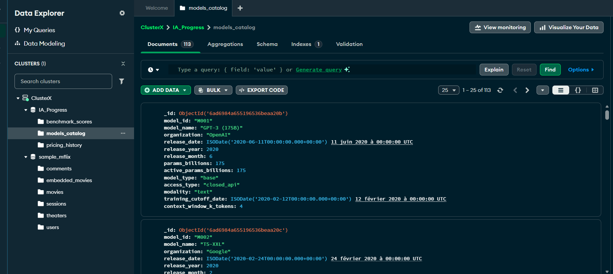
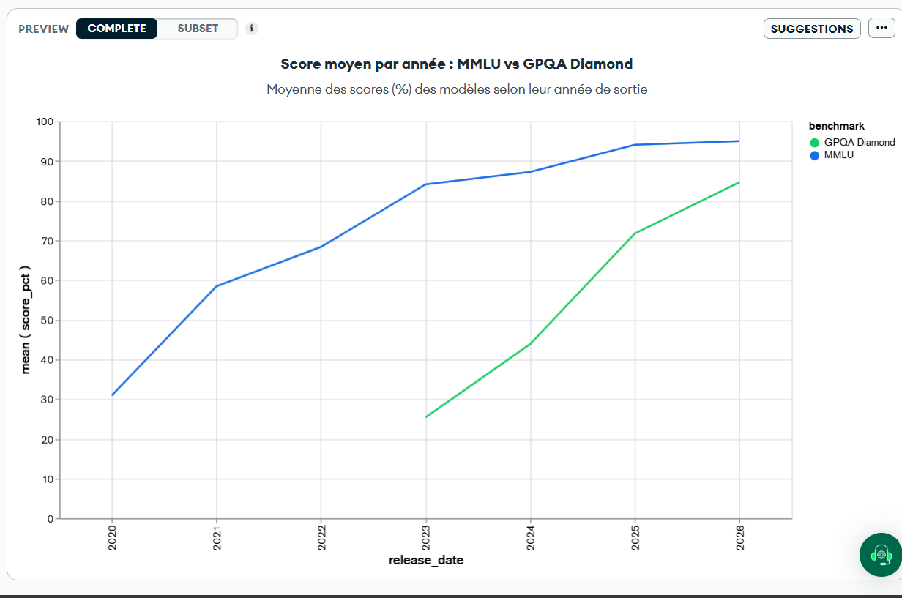
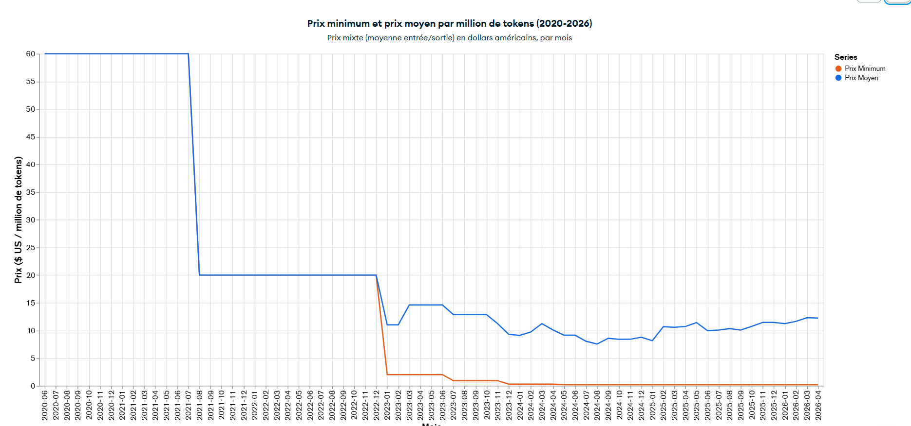
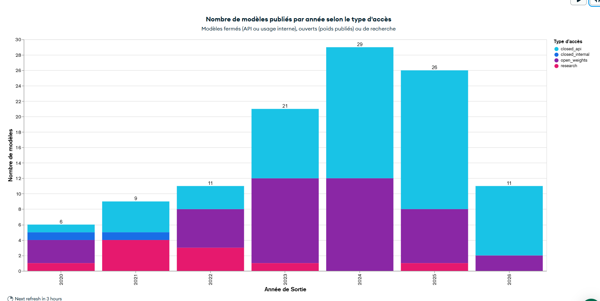
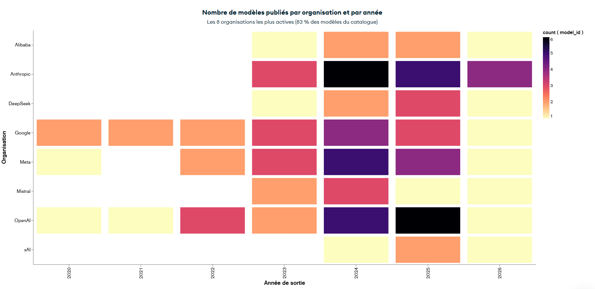

# The Evolution of AI Models (2020-2026) with MongoDB Atlas

Analysis of six years of large language model (LLM) releases, benchmark scores and API pricing, using **MongoDB Atlas**, **MQL queries in mongosh** and **Atlas Charts** dashboards.

> Academic project: SDD 1003 *Data Warehouse Management*, Université du Québec à Trois-Rivières (UQTR), fall 2026.


---

## Key findings

- **Benchmarks saturate quickly.** The average MMLU score went from about 31% (2020) to 95% (2026) and has been almost flat since 2025. The much harder GPQA Diamond test, introduced in 2023, went from about 25% to 85% in three years.
- **The cheapest model costs about 320 times less.** In 2020 the only available model cost $60 per million tokens; by 2024 the cheapest one cost $0.19.
- **The market has split into two tiers.** The average price fell to about $8 in 2024, then rose back to about $12 in 2026 with the arrival of high-end models, while very cheap models kept getting cheaper.
- **Closed models dominate again.** 2023 was the only year when open-weight models outnumbered closed ones (LLaMA, Mistral). Research-only models have nearly disappeared since 2022.
- **The race went global after ChatGPT.** Before 2023 only Google, OpenAI and Meta released models. Since then Anthropic, Mistral, DeepSeek, Alibaba and xAI have joined, and 2024-2025 were the busiest years.

## Dataset

[LLM Benchmarks & Capabilities 2020-2026](https://www.kaggle.com/datasets/sergionefedov/llm-benchmarks-and-capabilities-2020-2026) (Kaggle). Three of its CSV files were used:

| File | Rows | Content |
|---|---|---|
| `benchmark_scores.csv` | 1,276 | Score of each model on each benchmark |
| `models_catalog.csv` | 113 | Organization, release date, size, access type, modality |
| `pricing_history.csv` | 1,187 | Monthly input / output / blended price per million tokens |

Some values (parameter counts, training costs) are estimates rather than official figures, so the analysis focuses on overall trends rather than exact values.

The data is **not** redistributed in this repository. Please download it from Kaggle.

## Data model

- Database `IA_Progress` on a free **M0 Atlas cluster**, with one collection per CSV file.
- **Referencing instead of embedding:** the collections are linked by `model_id` (a one-to-many relationship between a model and its scores or monthly prices).
- **Types converted at import:** dates as `ISODate`, numeric fields as `Double`.



## Queries

All queries are in [`queries.js`](queries.js).

| # | Question | MQL features |
|---|---|---|
| 1 | Which models score at least 70% on SWE-Bench Verified? | `$and`, `$gte`, projection |
| 2 | Which models activate only part of their parameters (active < total)? | `$expr`, `$lt` (field-to-field comparison) |
| 3 | What were the 5 cheapest models in April 2026? | `.sort()`, `.limit()` |
| 4 | Which models have an average input/output price of at least $40 per 1M tokens in April 2026? | `$expr`, `$avg`, computed field in projection |

**Example (query 1):**

```js
db.benchmark_scores.find(
  { $and: [ { benchmark: "SWE-Bench Verified" }, { score_pct: { $gte: 70 } } ] },
  { _id: 0, model_name: 1, organization: 1, release_date: 1, score_pct: 1 }
)
```

Excerpt of the output: Claude Opus 4.6 (82.66%), Gemini 3.5 Pro (79.84%), Grok-5 (74.42%), GPT-5.5 (71.04%).

## Visualizations (Atlas Charts)

*Chart labels are in French.*

### 1. Average score per year: MMLU vs GPQA Diamond
Discrete line chart, scores binned by release year, aggregated with MEAN.



### 2. Minimum and average price per million tokens
Monthly line chart comparing MIN and MEAN of the blended price.



### 3. Models released per year by access type
Stacked column chart (COUNT), split into closed API, closed internal, open weights and research.



### 4. Models released per organization and year
Heatmap (COUNT of `model_id`) limited to the 8 most active organizations (83% of the catalog).



## How to reproduce

1. Create a free M0 cluster on [MongoDB Atlas](https://www.mongodb.com/atlas).
2. Download the three CSV files from Kaggle.
3. In **MongoDB Compass**, create the database `IA_Progress` and import each file into a collection with the same name (`benchmark_scores`, `models_catalog`, `pricing_history`). Set date fields to `Date` and numeric fields to `Double` during import.
4. Run the queries:
   ```bash
   mongosh "<your Atlas connection string>" --file queries.js
   ```
5. Optionally, rebuild the dashboards in **Atlas Charts** using the descriptions above.

## Debugging tips I used

- Test each condition of a query separately with `countDocuments()` before combining them.
- Double-check database and field names: MongoDB is case-sensitive.

## Tools

MongoDB Atlas (M0) · MongoDB Compass · mongosh · Atlas Data Explorer · Atlas Charts · Kaggle

## Author

**Awa Sermé**, B.Sc. Computer Science (Data Science), UQTR
[LinkedIn](https://www.linkedin.com/in/awa-serm%C3%A9/)
